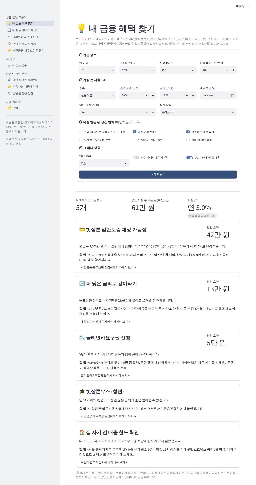
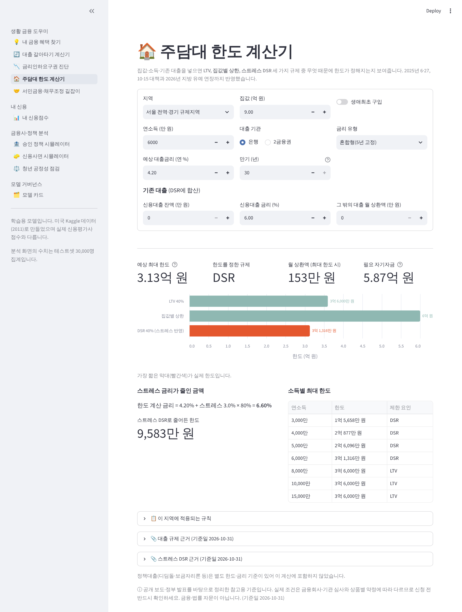
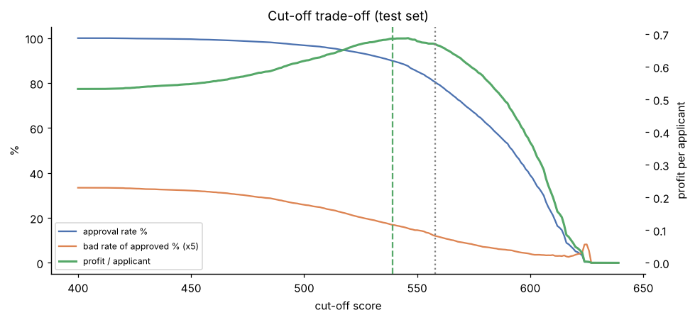
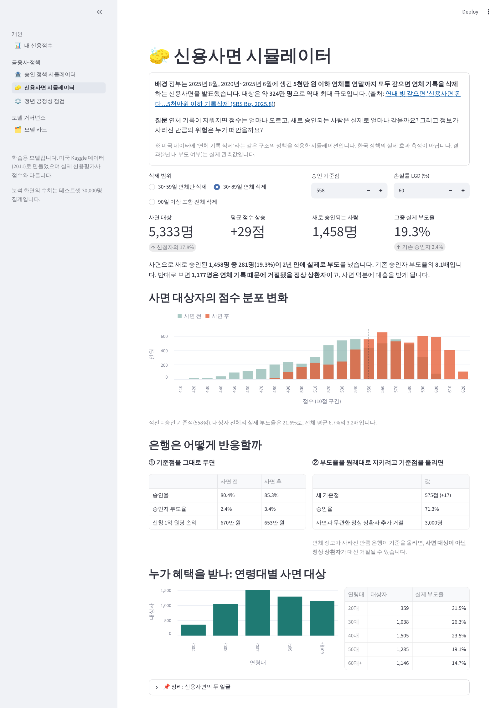
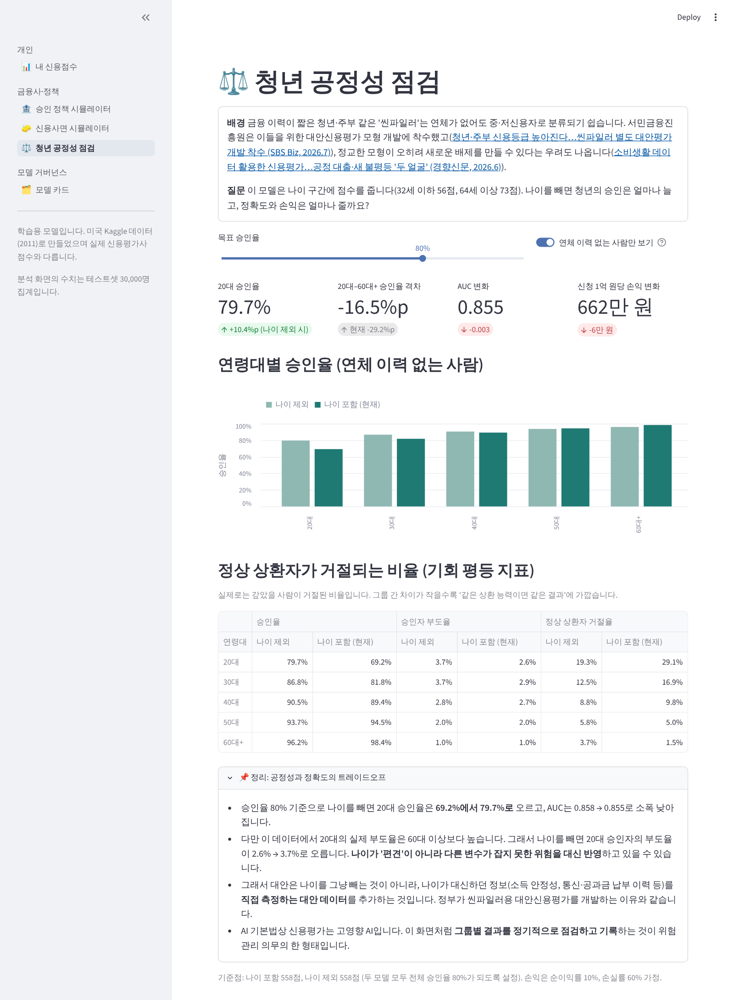

# 생활 금융 도우미 & 신용평가 스코어카드

> **v3** 바뀐 대출 제도(햇살론 통합, 중도상환수수료 인하, 금리인하요구 자동 신청, 스트레스 DSR, 10·15 대책)를 일반인이 **실제로 돈을 아끼는 데** 쓰도록 만든 생활 금융 도우미입니다.
> **최신** 프레디맥이 2026년 10월 공개한 미국 실제 주택담보대출 15만 건(2021~2023 실행, 2026.6까지 상환 기록)으로 금리 급등기 부도 위험을 시간 기준으로 검증했습니다.
> **v1~v2** 15만 명 대출 데이터(Kaggle, 2011)로 스코어카드를 만들고 승인 기준점의 손익을 분석한 뒤, 신용사면·청년 공정성·AI 기본법을 같은 모델로 검증했습니다.

**🔗 서비스**: `https://<배포주소>.streamlit.app` <!-- 배포 주소로 교체 --> · **💻 코드**: [github.com/Ksm1206/credit-scoring](https://github.com/Ksm1206/credit-scoring) · **📓 분석 노트북**: [`notebooks/01_credit_scorecard.ipynb`](notebooks/01_credit_scorecard.ipynb)

## 최신 실제 데이터: 금리 급등기 미국 주택담보대출 15만 건 (Freddie Mac, 2026.10 공개)

📓 [`notebooks/02_freddie_mac_mortgage.ipynb`](notebooks/02_freddie_mac_mortgage.ipynb) · 앱 화면 🇺🇸 **미국 주택담보대출 분석 (2021~23)**

| 실행 연도 | 금리 중앙값 | DTI 중앙값 | 24개월 부도율 |
|---|---|---|---|
| 2021 | 2.99% | 35 | 0.58% |
| 2022 | 5.25% | 39 | 1.45% |
| 2023 | 6.75% | 40 | 1.49% |

- **시간 기준 검증**: 2021~22년 대출로 학습하고 학습에 안 쓴 **2023년 대출**로 평가 → 스코어카드 AUC **0.799** (검증 0.808), LightGBM 0.810, FICO 단독 0.770
- **금리 급등 후 재보정**: 순위는 맞혔지만 2023년 부도 수준을 약 30% 낮게 예측(1.03% vs 실제 1.49%) → 절편 재보정, 같은 위험 유지하려면 기준점 +11점
- **금리는 가산폭으로**: 원시 금리는 시기 차이로 분포가 완전히 바뀜(PSI 6.49) → 같은 분기 대비 가산폭은 0.19
- **DTI 40 초과는 DTI 30 이하보다 부도율 약 3배** → 한국 DSR 40% 한도의 근거를 실제 데이터로 확인
- **생애최초 구입자 자체는 위험하지 않음**: 단순 비교 +0.35%p → 신용점수·LTV를 맞추면 −0.02%p
- **실제 손실은 작았음**: 부도 대출 중 2026.6까지 청산 7%, 청산 손실률 약 10% → 최근 실적만 보면 전원 승인이 최적이지만, 위기 손실(40%) 가정 시 기준점 587점(승인율 93%)이 최적 → 정책은 **스트레스 시나리오**로

## v3: 생활 금융 도우미 (기준일 2026-10-31)

| 화면 | 해결하는 문제 | 반영한 제도 |
|---|---|---|
| 💡 내 금융 혜택 찾기 | 1분 진단으로 나에게 해당하는 혜택만 **연간 절약액 순으로** 정렬 | 아래 전부 |
| 🔄 대출 갈아타기 계산기 | 수수료·부대비용을 빼고도 이득인지, 몇 달 만에 본전인지 | 중도상환수수료 개편(2025.1.13), 3년 후 면제 |
| 📉 금리인하요구권 진단 | 신청 사유 해당 여부, 인하폭별 절약액, 신청 방법 | 마이데이터 자동 신청(2026.2), 수용률 19.1%(2026 상반기) |
| 🏠 주택담보대출 한도 계산기 | LTV·집값별 상한·스트레스 DSR 중 무엇이 한도를 막는지 | 6·27, 10·15 대책, 스트레스 금리 3%(수도권)·0.75%(지방, 2026년 말까지) |
| 🤝 서민금융·채무조정 길잡이 | 정책 대출 자격, 연체 단계별 창구, 불법 금리 판별 | 햇살론 통합·상한 12.5%(2026.1.2), 새도약기금, 최고금리 20% |

- **정책 규칙은 코드와 분리**: `app/rules/rules_2026.json`에 수치·기준일·근거 기사를 함께 저장했습니다. 제도가 바뀌면 이 파일만 고치면 됩니다.
- **계산 로직은 단위 테스트**: `src/finance_calc.py` + `tests/test_finance_calc.py` (원리금 공식 검산, 수수료 슬라이딩, 한도 제약 3종, 자격 판정)
- 모든 화면에 근거 자료 링크와 "참고용·금융자문 아님" 안내를 붙였습니다.

| 내 금융 혜택 찾기 | 주택담보대출 한도 계산기 |
|---|---|
|  |  |

## 핵심 결과 (v1 스코어카드)

| | 스코어카드 (운영 모델) | LightGBM (챌린저) |
|---|---|---|
| AUC / KS (테스트 3만 명) | 0.858 / 0.560 | 0.869 / 0.583 |
| 설명 가능성 | 구간별 점수표, 9개 변수 | SHAP 필요 |
| 승인율 80%일 때 승인된 부도자 | 577명 | 537명 (−40명) |

- **승인율 80% 정책 (558점↑ 승인)**: 승인자 부도율 6.7% → **2.4%**, 부도자의 **71%를 사전 차단**, 1인당 손익은 전원 승인 대비 **+26%**
- **손익 최대 기준점은 539점 (승인율 90%)**: 손익 +29%. 80% 목표는 부도 손실이 이익의 약 10배일 때만 최적이다. 따라서 **승인율 목표는 손실 구조에 맞춰 정해야 한다**.
- LightGBM의 추가 이득은 손익 +0.8%에 불과하다. 그래서 설명 가능한 스코어카드를 운영 모델로 권고한다.



## v2: 사회 이슈 검증 (테스트셋 30,000명, 기준점 558점)

| 이슈 | 질문 | 결과 |
|---|---|---|
| **신용사면** (2025.8, 약 324만 명) | 연체 기록을 지우면 누가 승인되고 손실은 누가 떠안나 | 30~89일 연체 삭제 시 5,333명 평균 +29점. 새로 승인된 1,458명의 실제 부도율 **19.3% (기존 승인자의 8.1배)**. 부도율을 지키려 기준점을 올리면(575점) **사면과 무관한 정상 상환자 3,000명**이 대신 거절됨 |
| **청년 씬파일러** (2026.7 서민금융진흥원 대안평가 착수) | 나이 변수를 빼면 청년에게 공정해지나 | 연체 이력 없는 20대 승인율 **69.2% → 79.7%**, AUC는 0.858 → 0.855로 소폭 하락. 다만 20대 승인자 부도율도 2.6% → 3.7%로 올라, 나이가 다른 변수가 못 잡는 위험을 대신 반영하고 있음 → **대안 데이터로 직접 측정**이 해법 |
| **AI 기본법** (2026.1 시행, 신용평가 = 고영향 AI) | 법이 요구하는 수준으로 모델을 설명·관리할 수 있나 | 개인별 감점 사유 Top 3, 사람 심사 요청, 점수표 전체 공개, PSI·CSI 안정성 점검을 담은 **모델 카드** |

※ 미국 데이터에 같은 구조의 정책을 적용한 시뮬레이션입니다(한국 정책 효과 측정 아님). 부도 여부는 실제 관측값입니다.

## 서비스 화면 (5개 페이지)
| 화면 | 대상 | 기능 |
|---|---|---|
| 📊 내 신용점수 | 개인 | 점수·등급·상위 %, 감점 사유 설명서, 사람 심사 요청, 점수 올리는 법, A/B 실험 |
| 🏦 승인 정책 시뮬레이터 | 금융사 | 마진·손실률·기준점 조절 → 손익 곡선, 최적 기준점, 민감도 히트맵, 모델 비교 |
| 🧽 신용사면 시뮬레이터 | 정책 | 삭제 범위별 점수 변화, 신규 승인자 실제 부도율, 은행 대응 시 정상 고객 피해, 연령대별 수혜 |
| ⚖️ 청년 공정성 점검 | 정책 | 나이 포함/제외 모델의 연령대별 승인율·부도율·정상 상환자 거절율 |
| 🗂️ 모델 카드 | 거버넌스 | AI 기본법 의무 대응표, 성능, IV·CSI, 점수표 전체, 한계 |

| 신용사면 시뮬레이터 | 청년 공정성 점검 |
|---|---|
|  |  |

배포 환경과 같은 PostgreSQL에 연결해 브라우저로 5개 화면을 모두 검증했습니다(페이지 이동 시 사용자 ID 유지, 페이지별 방문·사람 심사 요청 기록). v1 검증 내용은 [기획서 부록 A](docs/신용평가_프로젝트_기획서.pdf)에 있습니다.

## 구조
```
notebooks/01_credit_scorecard.ipynb  EDA → WoE/IV → 스코어카드 → LightGBM → cut-off 손익 분석
src/scorecard.py                     binning·WoE·점수 스케일링 (노트북과 앱이 공유)
models/scorecard.json, policy.json   서비스용 점수표, 등급·승인 기준
models/scorecard_noage.json          나이 제외 비교 모델
models/mortgage_scorecard.json       프레디맥 주택담보대출 스코어카드
models/mortgage_artifacts.json       주택담보대출 화면용 집계 (원본 행 없음)
scripts/prepare_freddie.py           프레디맥 원자료 → 대출 단위 테이블 (24개월 부도 정의)
src/mortgage_model.py                숫자형+범주형 WoE 스코어카드
notebooks/02_freddie_mac_mortgage.ipynb  최신 데이터 분석 노트북
models/policy_artifacts.json         정책 화면용 집계 데이터 (원본 행 없음, 점수·그룹별 인원수만)
analysis/build_policy_artifacts.py   신용사면·공정성·모델 비교 집계 생성
app/app.py                           멀티페이지 진입점 (st.navigation)
app/views/*.py                       10개 화면 (v3_*: 생활 금융 도우미)
app/rules/rules_2026.json            v3 정책 규칙·기준일·근거 (제도 변경 시 이 파일만 수정)
src/finance_calc.py                  상환·수수료·갈아타기·DSR 한도·자격 판정 계산
app/common.py, app/events.py         공통 로딩·사용자 식별·손익 계산 / 이벤트 로깅
analytics/queries.sql                퍼널 · A/B · 리텐션 · 유입경로 SQL
analytics/analyze.py, dashboard.py   z-검정, 신뢰구간, 필요 표본 수 / 운영 대시보드
analytics/simulate_logs.py           ⚠️ 연습용 가상 로그 (실제 성과로 인용 금지)
docs/                                기획서·요약 PDF, 발표 PPT, 데이터 출처, 블로그 초안, 화면 캡처
scripts/                             데이터 수집(미러 해시 대조)·정리
tests/smoke_test.py                  10개 화면·수치·DB 로깅 자동 점검
tests/test_finance_calc.py           v3 계산 로직 단위 테스트 (pytest)
```

## 실행
```bash
pip install -r requirements-dev.txt
bash scripts/collect_data.sh && python scripts/prepare_data.py      # 데이터 (약 1분)
python notebooks/build_notebook.py && jupyter nbconvert --execute --inplace --to notebook notebooks/01_credit_scorecard.ipynb
python analysis/build_policy_artifacts.py                           # 정책 화면 집계 (데이터 필요)
python -m pytest tests/test_finance_calc.py -q                      # 계산 로직 테스트
python tests/smoke_test.py                                          # 배포 전 점검 (ALL PASSED 확인)
streamlit run app/app.py                                            # 앱
python analytics/analyze.py                                         # 로그 분석
streamlit run analytics/dashboard.py                                # 대시보드
```

## A/B 테스트 설계
| 항목 | 내용 |
|---|---|
| 가설 | 점수만 보여주는 것보다 "점수 올리는 방법"을 먼저 보여주면 사용자가 더 도움을 느낀다 |
| A (기본형) | 항목별 점수 차트, 개선 팁은 버튼을 눌러야 보임 |
| B (코칭형) | 개선 팁 카드를 먼저 노출, 차트는 접힘 |
| 배정 | 익명 사용자 ID 해시 50:50 (재방문해도 같은 군) |
| 1차 지표 | 결과 조회자 중 👍 비율 |
| 2차 지표 | 재계산률, 공유율, D1~7 재방문율 |
| 표본 | 기준 35%에서 +5%p 검출(검정력 80%)에 **군당 약 1,400명** 필요 → 사용자 규모에 맞춰 기간 결정 |

## 참고 기사
- [연내 빚 갚으면 '신용사면'된다…5천만원 이하 기록삭제 (SBS Biz, 2025.8)](https://biz.sbs.co.kr/amp/article/20000252645)
- [청년·주부 신용등급 높아진다…씬파일러 별도 대안평가 개발 착수 (SBS Biz, 2026.7)](https://biz.sbs.co.kr/amp/article/20000321310)
- [소비생활 데이터 활용한 신용평가…공정 대출·새 불평등 '두 얼굴' (경향신문, 2026.6)](https://www.khan.co.kr/article/202606162036005/amp)
- [AI 기본법 시행과 금융권 고영향 AI (비즈니스워치, 2026.1)](https://news.bizwatch.co.kr/article/finance/2026/01/23/0033)

## 데이터 출처
| 데이터 | 원 출처 | 용도 |
|---|---|---|
| **Freddie Mac SFLLD Release 48** (2021~23 대출 150,000건) | [Freddie Mac (2026.10)](https://freddiemac.com/research/datasets/sf-loanlevel-dataset) | 최신 주택담보대출 부도 모델·시간 기준 검증 |
| Give Me Some Credit (150,000명) | [Kaggle 대회 (2011)](https://www.kaggle.com/c/GiveMeSomeCredit) | v1 모델 학습·평가 |
| LendingClub LoanStats3a (2007–2011) | LendingClub 공개 대출 실적 데이터 | 수집 완료, 금액 기반 손익 재검증 예정 |
| Statlog German Credit (1,000명) | [UCI ML Repository](https://archive.ics.uci.edu/dataset/144/statlog+german+credit+data) | 연습용 |

원본 재배포 규정 때문에 데이터 파일은 저장소에 포함하지 않았습니다. `scripts/collect_data.sh`가 공개 미러 2곳에서 받아 SHA-256을 대조합니다. 미러 주소, 커밋, 해시, 이용 조건, 참고문헌은 **[docs/DATA_SOURCES.md](docs/DATA_SOURCES.md)**에 정리했습니다.

방법론 참고: Siddiqi, N. (2017). *Intelligent Credit Scoring* (2nd ed.). Wiley.

## 한계
- GMSC에는 대출금액·금리가 없어 손익을 1건당 동일 금액으로 가정했다 (민감도 분석 포함).
- `debt_ratio`·`monthly_income` 일부 구간의 점수가 비단조적이다. 원천 데이터에서 소득 결측자의 DTI가 금액으로 기록된 문제로 추정되며, 단조 binning 적용이 다음 과제다.
- 거절자 성과를 추론하지 않았고(Reject Inference), 랜덤 분할이라 시간 안정성 검증은 별도로 필요하다.
- 앱은 미국 데이터로 학습한 학습용 모델이며, 실제 신용평가사 점수와 다르다.
