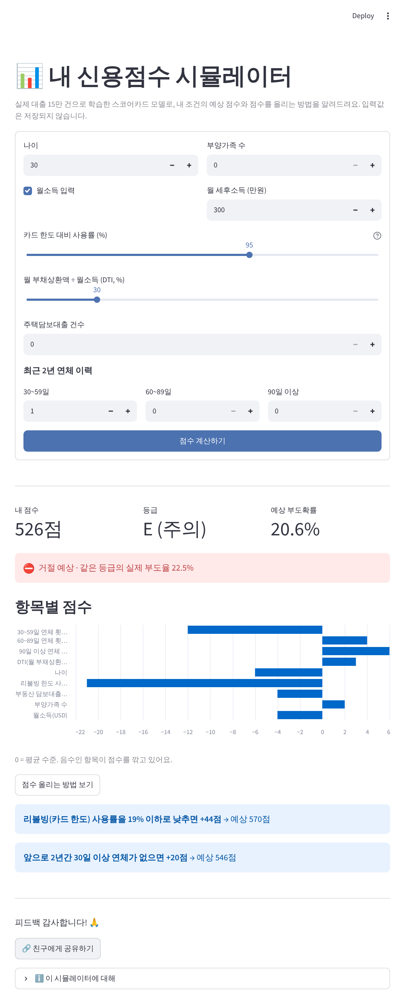
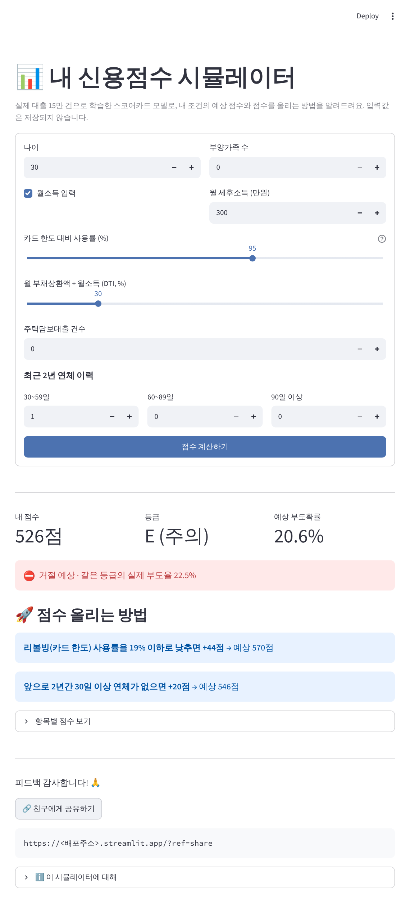

# 개인 신용평가 스코어카드 & 신용점수 시뮬레이터

> 15만 명 대출 데이터로 스코어카드를 만들고, **"몇 점부터 승인해야 손익이 가장 좋은가"**를 분석했습니다.
> 이 모델을 웹 서비스로 배포한 뒤, 실사용자 로그로 퍼널·리텐션·A/B 테스트를 분석합니다.

**🔗 서비스**: `https://<배포주소>.streamlit.app` · **📓 분석 노트북**: [`notebooks/01_credit_scorecard.ipynb`](notebooks/01_credit_scorecard.ipynb)

## 핵심 결과

| | 스코어카드 (운영 모델) | LightGBM (챌린저) |
|---|---|---|
| AUC / KS (테스트 3만 명) | 0.858 / 0.560 | 0.869 / 0.583 |
| 설명 가능성 | 구간별 점수표, 9개 변수 | SHAP 필요 |
| 승인율 80%일 때 승인된 부도자 | 577명 | 537명 (−40명) |

- **승인율 80% 정책 (558점↑ 승인)**: 승인자 부도율 6.7% → **2.4%**, 부도자의 **71%를 사전 차단**, 1인당 손익은 전원 승인 대비 **+26%**
- **손익 최대 기준점은 539점 (승인율 90%)**: 손익 +29%. 80% 목표는 부도 손실이 이익의 약 10배일 때만 최적이다. 따라서 **승인율 목표는 손실 구조에 맞춰 정해야 한다**.
- LightGBM의 추가 이득은 손익 +0.8%에 불과하다. 그래서 설명 가능한 스코어카드를 운영 모델로 권고한다.


## 서비스 화면
| A군 (기본형) | B군 (코칭형) |
|---|---|
|  |  |

배포 환경과 같은 PostgreSQL에 연결해 브라우저로 검증했습니다(점수 계산, A/B 배정, 이벤트 14건 기록). 검증 내용은 [기획서 부록 A](docs/신용평가_프로젝트_기획서.pdf)에 있습니다.

## 구조
```
notebooks/01_credit_scorecard.ipynb  EDA → WoE/IV → 스코어카드 → LightGBM → cut-off 손익 분석
src/scorecard.py                     binning·WoE·점수 스케일링 (노트북과 앱이 공유)
models/scorecard.json, policy.json   서비스용 점수표, 등급·승인 기준
app/app.py, app/events.py            Streamlit 시뮬레이터 + 이벤트 로깅 + A/B 배정
analytics/queries.sql                퍼널 · A/B · 리텐션 · 유입경로 SQL
analytics/analyze.py, dashboard.py   z-검정, 신뢰구간, 필요 표본 수 / 운영 대시보드
analytics/simulate_logs.py           ⚠️ 연습용 가상 로그 (실제 성과로 인용 금지)
docs/                                기획서·요약 PDF, 발표 PPT, 데이터 출처, 블로그 초안, 화면 캡처
scripts/                             데이터 수집(미러 해시 대조)·정리
tests/smoke_test.py                  점수 계산·A/B 화면·DB 로깅 자동 점검
```

## 실행
```bash
pip install -r requirements-dev.txt
bash scripts/collect_data.sh && python scripts/prepare_data.py      # 데이터 (약 1분)
python notebooks/build_notebook.py && jupyter nbconvert --execute --inplace --to notebook notebooks/01_credit_scorecard.ipynb
python tests/smoke_test.py                                          # 배포 전 점검 (ALL PASSED 확인)
streamlit run app/app.py                                            # 앱
python analytics/analyze.py                                         # 로그 분석
streamlit run analytics/dashboard.py                                # 대시보드
```

## A/B 테스트 설계
| 항목 | 내용 |
|---|---|
| 가설 | 점수만 보여주는 것보다 "점수 올리는 방법"을 먼저 보여주면 사용자가 더 도움을 느낀다 |
| A (기본형) | 항목별 점수 차트, 개선 팁은 버튼을 눌러야 보임 |
| B (코칭형) | 개선 팁 카드를 먼저 노출, 차트는 접힘 |
| 배정 | 익명 사용자 ID 해시 50:50 (재방문해도 같은 군) |
| 1차 지표 | 결과 조회자 중 👍 비율 |
| 2차 지표 | 재계산률, 공유율, D1~7 재방문율 |
| 표본 | 기준 35%에서 +5%p 검출(검정력 80%)에 **군당 약 1,400명** 필요 → 사용자 규모에 맞춰 기간 결정 |

## 데이터 출처
| 데이터 | 원 출처 | 용도 |
|---|---|---|
| Give Me Some Credit (150,000명) | [Kaggle 대회 (2011)](https://www.kaggle.com/c/GiveMeSomeCredit) | 모델 학습·평가 |
| LendingClub LoanStats3a (2007–2011) | LendingClub 공개 대출 실적 데이터 | 수집 완료, 금액 기반 손익 재검증 예정 |
| Statlog German Credit (1,000명) | [UCI ML Repository](https://archive.ics.uci.edu/dataset/144/statlog+german+credit+data) | 연습용 |

원본 재배포 규정 때문에 데이터 파일은 저장소에 포함하지 않았습니다. `scripts/collect_data.sh`가 공개 미러 2곳에서 받아 SHA-256을 대조합니다. 미러 주소, 커밋, 해시, 이용 조건, 참고문헌은 **[docs/DATA_SOURCES.md](docs/DATA_SOURCES.md)**에 정리했습니다.

방법론 참고: Siddiqi, N. (2017). *Intelligent Credit Scoring* (2nd ed.). Wiley.

## 한계
- GMSC에는 대출금액·금리가 없어 손익을 1건당 동일 금액으로 가정했다 (민감도 분석 포함).
- `debt_ratio`·`monthly_income` 일부 구간의 점수가 비단조적이다. 원천 데이터에서 소득 결측자의 DTI가 금액으로 기록된 문제로 추정되며, 단조 binning 적용이 다음 과제다.
- 거절자 성과를 추론하지 않았고(Reject Inference), 랜덤 분할이라 시간 안정성 검증은 별도로 필요하다.
- 앱은 미국 데이터로 학습한 학습용 모델이며, 실제 신용평가사 점수와 다르다.
