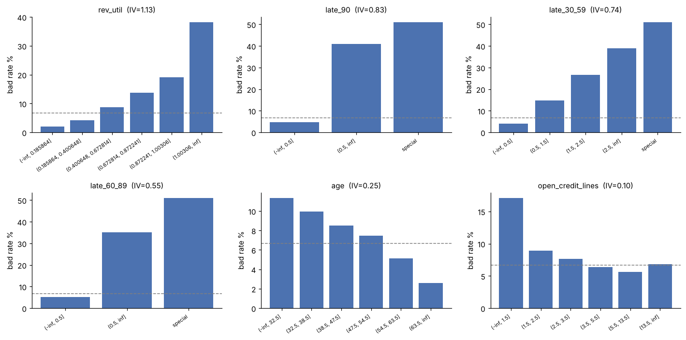
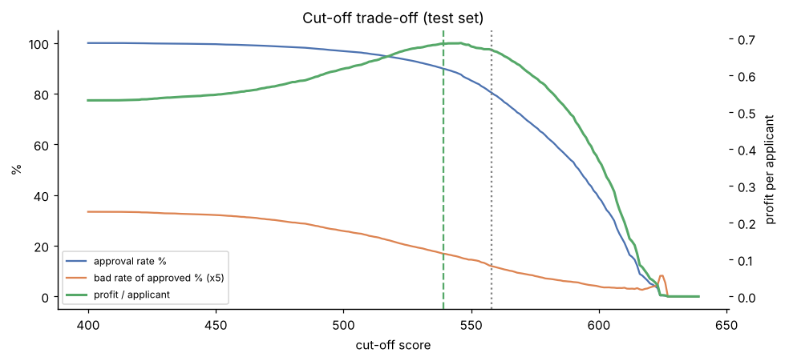

# 신용평가 모델, AUC보다 중요한 건 "몇 점부터 승인할까"였다

> 블로그 초안입니다. ✏️ 표시는 직접 채우거나 말투를 다듬을 부분이에요.

## 들어가며
✏️ (이 프로젝트를 시작한 이유를 1~2문장으로. 예: 데이터 분석가는 모델을 만드는 사람이 아니라 의사결정을 돕는 사람이라고 생각해서, "모델 이후"를 끝까지 따라가 보고 싶었다.)

이번에 다룬 질문은 하나다. **대출 신청자를 점수화했다면, 몇 점부터 승인해야 회사가 가장 돈을 많이 버는가?**

## 1. 데이터: 15만 명, 부도율 6.7%
Kaggle의 Give Me Some Credit 데이터를 썼다. 2년 안에 90일 이상 연체했는지가 타깃이다. 정리 과정에서 세 가지가 눈에 띄었다.

- **연체 횟수 96, 98**: 2년에 98번 연체할 수는 없다. 특수코드로 보고 별도 구간으로 뺐다. 이 269명의 부도율은 55%였다.
- **월소득 결측 20%**: 평균으로 채우고 싶었지만, 결측자 부도율(5.6%)이 기재자(6.9%)보다 낮았다. 평균으로 채웠다면 이 정보가 사라졌을 것이다. 그래서 결측을 하나의 구간으로 남겼다.
- **극단값**: 리볼빙 사용률 최댓값이 50,708(=5,070,800%)이었다. 구간화를 하면 이런 이상치는 자동으로 마지막 구간에 들어간다.

## 2. 왜 스코어카드인가
금융권은 아직 로지스틱 스코어카드를 많이 쓴다. 대출을 거절하면 **이유를 설명할 수 있어야** 하기 때문이다.

- 변수별로 부도율이 크게 갈리는 지점에서 구간을 나눴다(의사결정나무 사용).
- 각 구간을 WoE로 바꿔 로지스틱 회귀를 학습했다.
- "600점 = 정상:부도 50:1, 20점 오를 때마다 odds 2배" 기준으로 점수표를 만들었다.

여기서 한 가지 함정을 만났다. `보유 대출·카드 수`는 계수 부호가 거꾸로 나왔다. 다른 변수와 겹치는 정보 때문이었다. 부호가 반대인 변수는 점수표를 설명할 수 없어서 제거했다.

## 3. 성능: LightGBM이 더 좋다. 그런데 얼마나?
| | AUC | KS |
|---|---|---|
| 스코어카드 (9개 변수) | 0.858 | 0.560 |
| LightGBM (10개 변수) | 0.869 | 0.583 |

AUC 0.011 차이를 돈으로 바꿔보면 이렇다. 승인율 80%로 운영할 때 테스트 3만 명 중 **부도자를 40명 더 걸러낸다.** 손익으로는 **+0.8%**다. 설명 가능성을 포기할 만한 차이는 아니라고 판단했다.

## 4. 진짜 질문: 기준점을 어디에 둘까
대출금액 정보가 없어서 단순한 가정을 세웠다. 정상 고객은 **+1**, 부도 고객은 **−6**이다(마진 10%, 손실률 60%).

- **전원 승인**: 부도율 6.7%, 1인당 손익 0.53
- **승인율 80%** (558점↑): 부도율 **2.4%**, 부도자 **71% 차단**, 손익 **+26%**
- **손익 최대점** (539점↑, 승인율 90%): 손익 **+29%**

흔히 쓰는 "승인율 80%" 목표는 이 가정에서 최적이 아니었다. 손실/이익 비율을 바꿔가며 계산해 보니, 80%가 최적이 되려면 부도 1건 손실이 이익의 **10배**는 되어야 했다. **승인율 목표는 감이 아니라 손실 구조에서 나와야 한다.** 이 프로젝트에서 얻은 가장 큰 배움이다.

기준점은 검증셋에서 정하고, 성과는 테스트셋에서 쟀다. 같은 데이터로 기준점도 정하고 성과도 재면 결과가 부풀려진다.

## 5. 한계
- 실제 대출금액이 없어 손익은 가정에 의존한다. 그래서 민감도 분석을 함께 실었다.
- 거절된 사람이 실제로 갚았을지는 알 수 없다(Reject Inference).
- DTI 일부 구간의 점수가 직관과 반대다. 원천 데이터 오류로 보이며, 단조 구간화로 보완할 예정이다.

## 6. 다음 이야기
이 점수표를 **웹 서비스로 배포**했다. ✏️ (배포 주소) 지금은 실제 사용자 로그로 "점수만 보여줄 때 vs 개선 방법을 먼저 보여줄 때" A/B 테스트를 하고 있다. 결과는 다음 글에서 다룬다.

코드: ✏️ (GitHub 링크)
